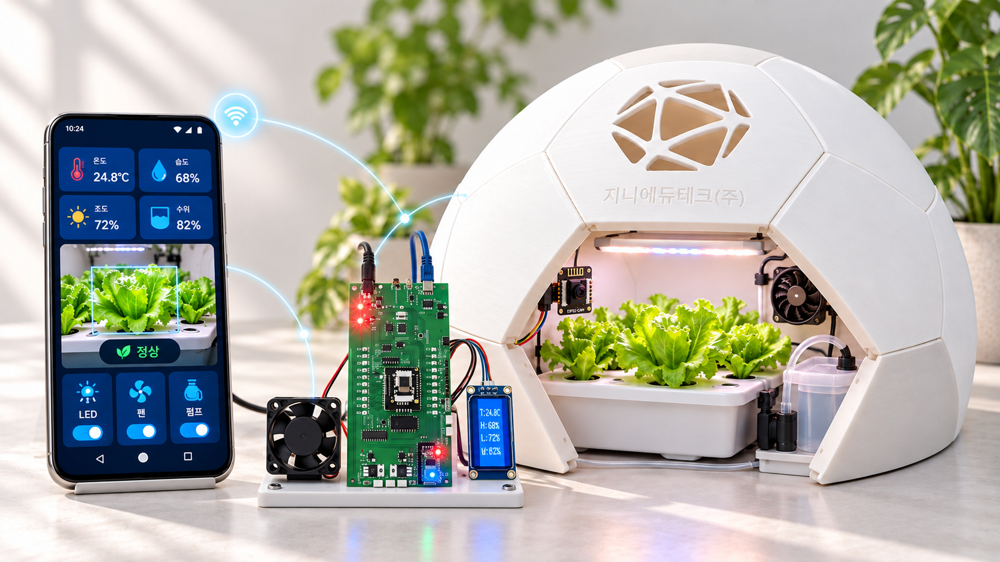
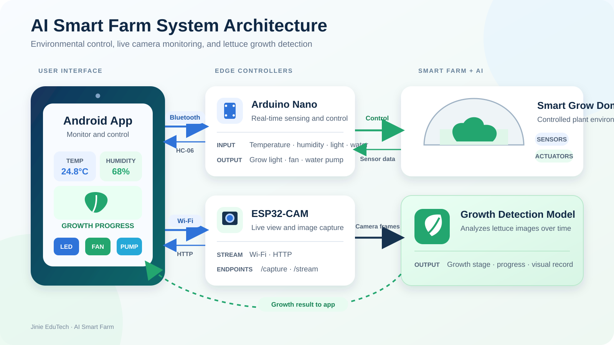

# AI Smart Farm

**English** | [한국어](README.ko.md)

<p align="center"></p>
<p align="center"><sub>Concept illustration</sub></p>

An indoor smart-farm kit for the classroom by Jinie EduTech. An MIT App Inventor
Android app shows the sensor readings, switches the grow light, fan and pump, and
opens the ESP32-CAM live camera. Machine-learning exercises are separate PC/Colab
lessons, not an app feature.

## Overview

| Part | What it does | Folder |
|------|--------------|--------|
| Controller | Arduino Nano reads the sensors, shows values on an LCD and switches the grow light, fan and pump | [`firmware/nano-controller`](firmware/nano-controller) |
| Camera | ESP32-CAM serves live video and still images over Wi-Fi | [`firmware/esp32-cam`](firmware/esp32-cam) |
| Android app | MIT App Inventor app: sensor data, manual controls, camera | [`android`](android) |
| Teaching deck | Data and machine learning with the AI smart farm (PowerPoint, Korean) | [`docs`](docs) |
| Plant-health AI | YOLOv8 / Keras lettuce classifier (separate repository) | [lettuce_ML](https://github.com/incom8134-web/lettuce_ML) |

## Download the app

- [Android APK (V11)](android/Ai_Smart_Farm_V11.apk?raw=true) – install on the phone.
- [MIT App Inventor project (V11)](android/Ai_Smart_Farm_V11.aia?raw=true) – editable source.
- [Install and test guide](android/README.md).

Teaching deck: [PowerPoint](<docs/AI 스마트팜 활용하는 데이터 와 기계학습_최종버전_v3_2026.10.14.pptx?raw=true>).

## System architecture

<p align="center"></p>

## Features

- Live temperature, humidity, light and water-level readings
- Remote on/off control of the grow light, fan and water pump
- Live camera view in the app
- Separate PC/Colab exercises for camera-image machine learning
- Language and theme settings in the app

## Hardware

| Component | Notes |
|-----------|-------|
| Arduino Nano | Main controller |
| HC-06 | Bluetooth Classic module |
| DHT11 | Temperature and humidity |
| Light sensor, water sensor | Analog inputs |
| 16x2 I2C LCD | Address `0x27` (use `0x3F` if an I2C scan shows it) |
| LED grow light, fan, water pump | Switched outputs |
| AI Thinker ESP32-CAM | Camera |

### Nano pin map

| Function | Pin |
|----------|-----|
| LED / grow light | D4 |
| DHT11 | D5 |
| Fan | D6 |
| Pump | D7 |
| HC-06 TX → Nano RX | D8 |
| HC-06 RX ← Nano TX | D9 |
| Light sensor | A0 |
| Water sensor | A1 |

## Setup

The [firmware guide](firmware/README.md) has the board settings, libraries, wiring,
protocol and the full upload procedure. In short:

1. Upload `firmware/esp32-cam/esp32-cam.ino` **first**. Keep its whole folder together.
   Set `WIFI_SSID` and `WIFI_PASSWORD` for the classroom's 2.4 GHz router.
   Select AI Thinker ESP32-CAM, ESP32 core 3.3.2, Core Debug Level **None**.
2. Open Serial Monitor at 115200 before resetting the ESP32 and note the camera IP it prints once.
3. Power off, switch the board to the Nano programming route and upload
   `firmware/nano-controller/nano-controller.ino` **second**.
4. Power off, select the normal operating mode, pair the HC-06 in Android settings
   and test each output one at a time.

| URL | Purpose |
|-----|---------|
| `http://<camera-ip>/` | Camera viewing page |
| `http://<camera-ip>:81/stream` | Live MJPEG stream |
| `http://<camera-ip>/capture` | Single JPEG image |
| `http://<camera-ip>/status` | Camera format |

The phone and the camera must be on the same router. Enter the camera IP printed
at startup into the app.

## Bluetooth protocol

Commands sent by the app (plain text, with `;` appended):

`LED_ON`, `LED_OFF`, `FAN_ON`, `FAN_OFF`, `PUMP_ON`, `PUMP_OFF`

Sensor packet sent by the Nano every two seconds:

```
temperature,humidity,lightRaw,waterRaw;
```

## Safety

The Nano runs in manual mode: sensors only report, and outputs change only when the
app sends a command. There is no automatic low-water or disconnect cutoff, and closing
the app does not stop a running pump. Send OFF and check that the pump really stops;
never let it run dry. Disconnect USB and external power before changing DIP switches.

## Repository layout

```
.
├── android/            Android app (.apk) and MIT App Inventor source (.aia)
├── firmware/
│   ├── nano-controller/  Arduino Nano firmware
│   ├── esp32-cam/        ESP32-CAM firmware
│   ├── sensor-tests/     Small sketches to test one part at a time
│   ├── serial-output-test/  Bench test: switch outputs from the Serial Monitor
│   └── check_firmware.py    Offline firmware check (developers)
├── images/             Figures used in this README
└── docs/               Teaching presentation (PowerPoint)
```
